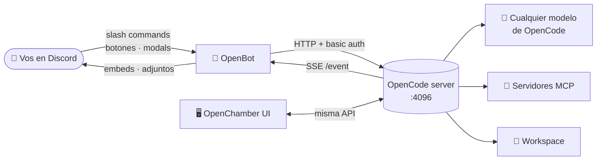
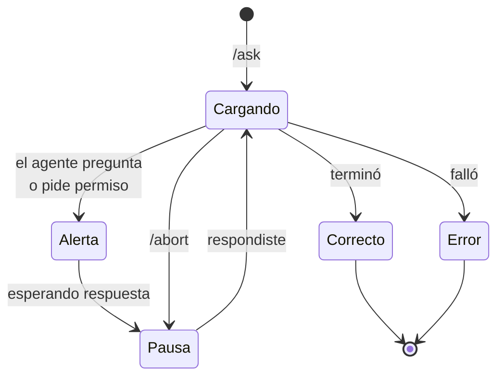
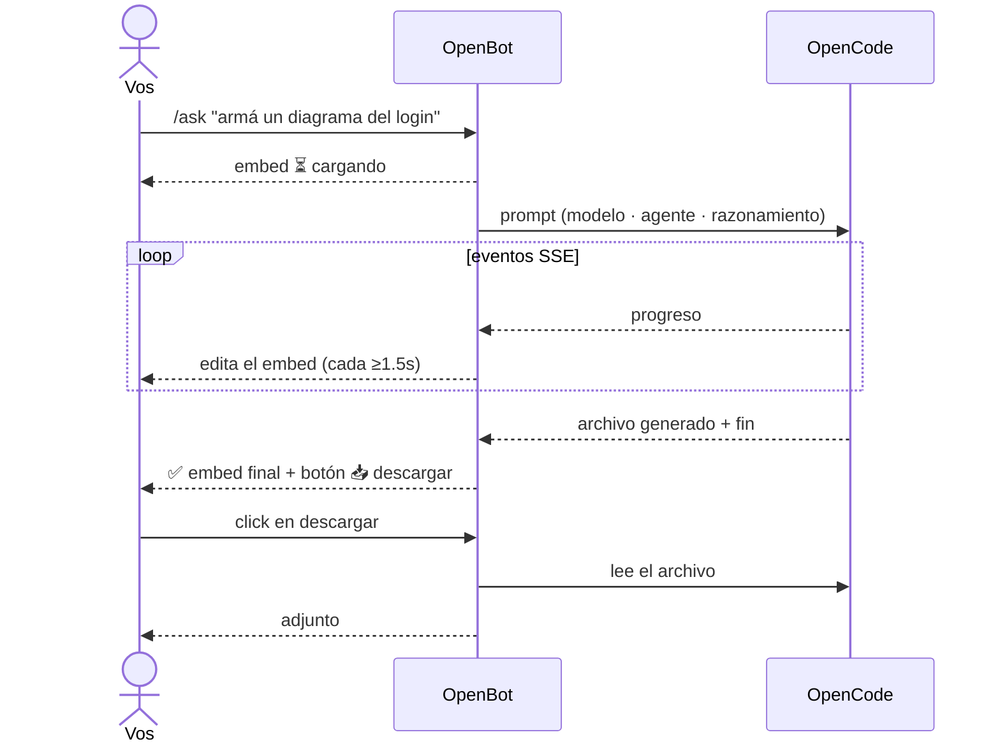
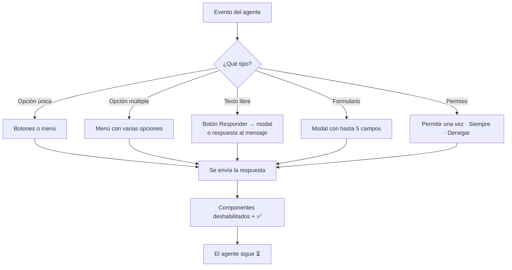
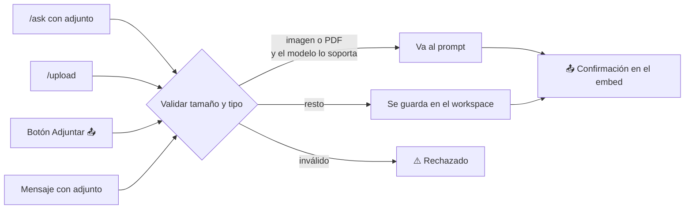

<div align="center">

# 🤖 OpenBot

**Manejá OpenChamber / OpenCode desde Discord.**
Mandá prompts, cambiá de modelo, razonamiento y agente, revisá el usage, subí y descargá archivos, y respondé las preguntas del agente sin salir del chat.


[Características](#-características) · [Arquitectura](#-arquitectura) · [Flujos](#-flujos) · [Comandos](#-comandos) · [Instalación](#-instalación) · [Roadmap](#-roadmap)

</div>

---

## ✨ Características

| | |
|---|---|
| 📊 **Usage en vivo** | Tokens (entrada, salida, razonamiento, caché) y costo por sesión y por día |
| 🧠 **Modelo y razonamiento** | Cambiá de modelo y nivel de razonamiento con autocompletado |
| 🕵️ **Agentes** | Cambiá de agente en la sesión activa |
| 🔌 **MCP** | Mirá qué servidores MCP están conectados, fallaron o están desactivados |
| 📥 **Descargas** | Documentos, imágenes y diagramas generados, con botón de descarga en el embed |
| 📤 **Subidas** | Adjuntá imágenes o archivos desde un comando, un botón o un mensaje |
| ❓ **Preguntas del agente** | Botones, menús o formularios según el tipo de pregunta; texto libre por modal o respuesta |
| 🔐 **Permisos** | Permitir una vez, permitir siempre o denegar, desde Discord |
| 🔄 **Sincronizado** | Las sesiones son las mismas que ves en OpenChamber y en la TUI |

---

## 🏗 Arquitectura



El bot no pasa por OpenChamber: habla con el **servidor de OpenCode**, el mismo backend que usa OpenChamber. Por eso todo lo que hacés desde Discord aparece también en la UI, y al revés.

---

## 🔀 Flujos

### Ciclo de vida de una tarea

Cada tarea usa **un solo mensaje** que se va editando, con los emojis custom del servidor.



| Estado | Emoji | Significado |
|---|---|---|
| Cargando | `:cargando:` (animado) | El agente está trabajando |
| Alerta | `:alerta:` (animado) | Necesita tu input o hubo un error |
| Pausa | `:pausa:` | Esperando respuesta, abortado o inactivo |
| Correcto | `:correcto:` (animado) | Tarea terminada |

### Prompt de punta a punta



### Preguntas y permisos



### Subir archivos



---

## 💬 Comandos

| Comando | Descripción |
|---|---|
| `/ping` | Verifica que el bot está conectado y que tenés acceso |
| `/status` | Sesión, modelo, razonamiento, agente, usage y MCP en un solo embed |
| `/usage` | Tokens y costo de la sesión y del día |
| `/model [modelo]` | Ver o cambiar el modelo |
| `/reasoning [nivel]` | Ver o cambiar el nivel de razonamiento (solo los que soporta el modelo) |
| `/agent [nombre]` | Ver o cambiar el agente |
| `/mcp` | Estado de los servidores MCP |
| `/session list \| new \| use <id>` | Manejar la sesión activa del canal |
| `/ask <prompt> [archivos]` | Mandar un prompt, con hasta 3 adjuntos |
| `/upload <archivo> [ruta]` | Subir un archivo al workspace |
| `/download <ruta>` | Descargar un archivo del workspace |
| `/abort` | Cortar la tarea en curso |

---

## 🚀 Instalación

### Requisitos

- Node.js 22 o superior
- Un servidor de OpenCode corriendo (`opencode serve`), o OpenChamber con su servidor
- Una aplicación de bot en el [Discord Developer Portal](https://discord.com/developers/applications)

### Pasos

```bash
git clone https://github.com/<tu-usuario>/openbot.git
cd openbot
npm install
cp .env.example .env     # completá las variables
npm run register         # registra los slash commands
npm run dev              # o: npm start
```

### Variables de entorno

| Variable | Descripción |
|---|---|
| `DISCORD_TOKEN` | Token del bot |
| `DISCORD_CLIENT_ID` | ID de la aplicación |
| `DISCORD_GUILD_ID` | ID del servidor donde se registran los comandos |
| `ALLOWED_USER_IDS` | IDs de usuarios autorizados, separados por coma |
| `NOTIFY_CHANNEL_ID` | Canal de notificaciones |
| `OPENCODE_URL` | URL del servidor de OpenCode (ej. `http://localhost:4096`) |
| `OPENCODE_SERVER_USERNAME` | Usuario de basic auth (por defecto `opencode`) |
| `OPENCODE_SERVER_PASSWORD` | Contraseña del servidor |
| `UPLOAD_DIR` | Carpeta de subidas (por defecto `./uploads/`) |
| `DB_PATH` | Base SQLite del bot (por defecto `./data/openbot.db`) |
| `MAX_FILE_MB` | Tamaño máximo de archivo (por defecto `10`) |
| `QUESTION_TIMEOUT_MIN` | Minutos antes de marcar una pregunta sin respuesta (por defecto `30`) |
| `EMOJI_*` | Emojis custom: `CORRECTO`, `ALERTA`, `CARGANDO`, `PAUSA`, `DESCARGA`, `CARGA` |

### 🎨 Emojis custom

El bot usa los emojis de tu servidor por ID. Para obtenerlo, escribí el emoji en Discord con una barra invertida adelante y mandalo:

```
\:correcto:   →   <a:correcto:123456789012345678>
\:pausa:      →   <:pausa:123456789012345678>
```

Copiá ese texto completo en la variable correspondiente. Los animados empiezan con `<a:`.

> [!TIP]
> Si falta algún ID, el bot usa un emoji Unicode equivalente y deja una advertencia en el log.

---

## 🔐 Seguridad

> [!WARNING]
> El bot puede ejecutar código en tu máquina a través del agente. Tratalo como un acceso remoto.

- Solo los usuarios de `ALLOWED_USER_IDS` pueden usar comandos, botones, formularios y subidas.
- Las credenciales viven solo en `.env` y nunca se muestran ni se loguean.
- Las rutas de subida y descarga se validan contra path traversal.
- Si un archivo supera `MAX_FILE_MB`, el bot lo comprime en zip; si sigue pasando el límite, te deja la ruta relativa.
- Los diagramas Mermaid/PlantUML se renderizan a PNG si `mmdc` o `plantuml` están en el PATH; si no, se adjunta la fuente.
- Si exponés OpenCode fuera de tu máquina, protegelo siempre con contraseña.

---

## 🗂 Estructura

```
.
├── src/                  # código fuente del bot
│   ├── commands/         # un archivo por comando
│   ├── interactions/     # botones, menús y modals
│   ├── opencode/         # cliente HTTP y eventos SSE
│   ├── files/            # subidas y descargas
│   ├── db/               # SQLite: conexión, consultas y migraciones
│   └── ui/               # embeds compartidos
├── skills/               # skills del agente de desarrollo
├── plans/                # una fase del plan por archivo
├── agent.md              # instrucciones del agente de desarrollo
└── readme.md
```

---

## 🛣 Roadmap

- [x] **P0** · Mapeo de la API y los eventos
- [x] **P1** · Esqueleto del bot
- [x] **P2** · Cliente de OpenCode
- [x] **P3** · Comandos de consulta (`/status`, `/usage`, `/mcp`)
- [x] **P4** · Cambio de modelo, razonamiento y agente
- [x] **P5** · Prompts y ciclo de vida de tareas
- [ ] **P6** · Descargas
- [ ] **P7** · Subidas
- [ ] **P8** · Preguntas y permisos
- [ ] **P9** · Robustez y despliegue como servicio

El detalle de cada fase está en [`plans/`](./plans/README.md), las reglas del agente de desarrollo en [`agent.md`](./agent.md) y su conocimiento técnico en [`skills/`](./skills/README.md).

---

<div align="center">

Hecho con OpenCode, OpenChamber y bastante mate 🧉

</div>
